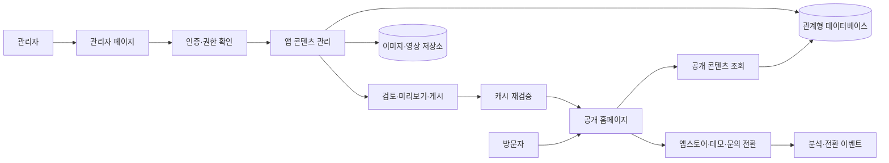
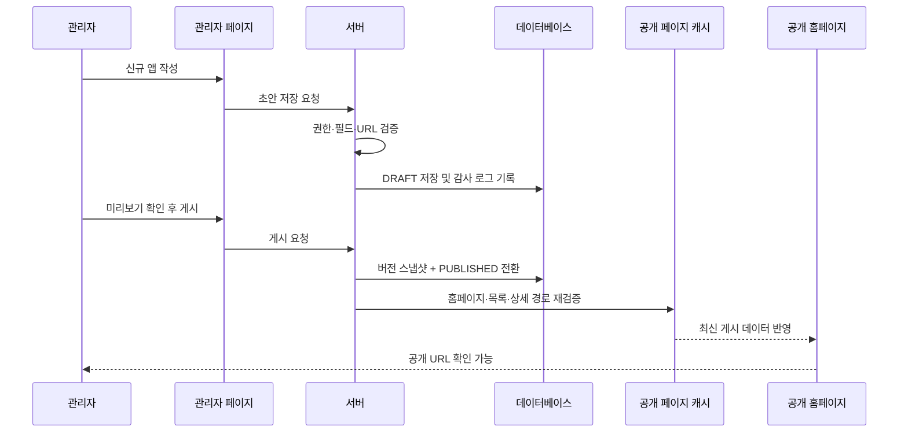

# HongLabAI 홈페이지·관리자 기반 포트폴리오 구축 기준 계획

| 항목 | 내용 |
|---|---|
| 문서 상태 | **Implementation Ready / 구현 기준 문서** |
| 버전 | 1.0 |
| 기준일 | 2026-07-18 |
| 대상 저장소 | `zeromorow-hub/honglabai` |
| 분석 기준 커밋 | `d3d519864bc8596ebb50510e6f56078acd4d038f` (`main`) |
| 문서 목적 | 관리자 페이지에서 앱을 등록·검토·게시하면 공개 홈페이지의 포트폴리오와 앱 상세 페이지에 자동 반영되는 구조를 정의한다. |

---

## 1. 문서의 역할과 변경 관리

이 문서는 HongLabAI 홈페이지를 단순한 AI 컨설팅 랜딩 페이지에서 **앱 포트폴리오 운영·홍보 플랫폼**으로 전환하기 위한 제품, UX, 데이터, 보안, 개발, 배포 기준이다.

구현 과정에서는 다음 원칙을 따른다.

1. 홈페이지·관리자·API·데이터베이스 관련 구현 PR은 이 문서의 해당 절을 기준으로 작성한다.
2. 데이터 모델, 게시 흐름, 권한 체계 또는 공개 URL 정책을 변경할 때는 코드보다 이 문서를 먼저 갱신한다.
3. 필수 범위는 `P0`, 출시 후 개선 범위는 `P1`, 장기 확장 범위는 `P2`로 관리한다.
4. 검증되지 않은 통계, 후기, 고객사 정보는 공개하지 않는다.
5. 관리자에서 앱을 추가하기 위해 소스 코드를 수정하거나 다시 배포해야 하는 구조는 완료로 인정하지 않는다.

---

## 2. 최종 아키텍처 결정

### 2.1 핵심 결정

현재의 React/Vite 단일 페이지를 다음 네 영역이 연결된 구조로 재구축한다.

1. **공개 홈페이지**: 앱 발견, 비교, 체험, 설치 및 제작 문의
2. **관리자 페이지**: 앱·이미지·홍보 순서·SEO·문의 관리
3. **서버 애플리케이션**: 인증, 권한, 검증, 게시, 문의, AI 기능
4. **데이터 계층**: 관계형 데이터베이스, 미디어 저장소, 변경 이력

권장 구현은 **Next.js App Router + TypeScript 기반의 단일 코드베이스**이다. 공개 페이지는 정적 생성 및 캐시 재검증을 활용하고, 관리자와 API는 서버 렌더링 또는 서버 전용 경로로 구성한다. 현재 사이트의 React 컴포넌트와 디자인 자산은 재사용한다.

### 2.2 전체 구조



### 2.3 단일 코드베이스를 선택하는 이유

- 현재 사이트 규모가 작아 별도 CMS와 프런트엔드를 분리하는 비용보다 통합 구조의 이점이 크다.
- 공개 사이트와 관리자가 동일한 타입·검증 규칙·앱 데이터를 공유할 수 있다.
- 앱 게시 직후 홈페이지, 목록, 상세 페이지 캐시를 한 번에 갱신할 수 있다.
- 관리자 기능은 검색엔진에 노출하지 않으면서 공개 페이지에는 앱별 메타데이터를 제공할 수 있다.
- 향후 앱 수와 운영 인력이 증가하면 API 또는 CMS를 분리할 수 있도록 서비스 계층을 독립 모듈로 둔다.

---

## 3. 현재 상태 진단

현재 저장소는 React 19, TypeScript, Vite 기반의 단일 랜딩 페이지이며 다음 순서로 구성되어 있다.

```text
Navbar → Hero → Features → Contact → Footer
```

확인된 주요 문제는 다음과 같다.

| 영역 | 현재 상태 | 보완 결정 |
|---|---|---|
| 포트폴리오 | 앱 목록과 상세 페이지가 없음 | 데이터 기반 앱 목록 및 `/apps/[slug]` 구축 |
| 콘텐츠 관리 | 코드 수정 외 관리 방법이 없음 | `/admin` 앱 CRUD 및 게시 흐름 구축 |
| 내비게이션 | `소개` 메뉴의 대상 섹션이 없음 | 실제 정보 구조와 메뉴를 일치시킴 |
| 문의 | 제출 시 데모 알림만 표시 | 서버 저장·이메일 알림·스팸 방지 적용 |
| AI 상담 | Gemini API 키가 클라이언트 번들에 포함될 수 있음 | 서버 전용 API로 이동 |
| 신뢰 정보 | `Projects 100+`, `Retention 98%` 등 검증 필요 | 출처가 있는 수치만 공개 |
| SNS | 링크가 `#`으로 설정됨 | 실제 URL 연결 또는 제거 |
| SEO | 앱별 제목·설명·공유 이미지·구조화 데이터 없음 | 앱 레코드 기반 자동 생성 |
| 성능 | 대형 3D iframe과 런타임 Tailwind CDN 의존 | 앱 화면 중심 디자인, 빌드 CSS, 지연 로딩 |
| 빌드 | `/index.css` 누락 및 대형 JS 청크 경고 | CSS 경로 정리, 서버 기능 분리, 코드 분할 |

---

## 4. 목표와 비범위

### 4.1 제품 목표

1. 방문자가 5초 안에 HongLabAI가 어떤 앱을 만들고 운영하는지 이해한다.
2. 방문자가 앱을 탐색한 뒤 체험, 앱스토어 이동, 알림 신청 또는 제작 문의 중 하나를 수행한다.
3. 관리자가 개발자 도움 없이 앱을 초안으로 등록하고 미리보기 후 게시한다.
4. 게시된 앱이 홈페이지 추천 영역, 전체 포트폴리오, 앱 상세 페이지 및 SEO 데이터에 자동 반영된다.
5. 공개 콘텐츠의 정확성, 변경 이력, 보안 및 복구 가능성을 운영 수준으로 확보한다.

### 4.2 성공 조건

- 앱 등록과 게시에 코드 변경이나 수동 배포가 필요하지 않다.
- 게시 후 60초 이내 공개 목록과 상세 페이지에서 확인할 수 있다.
- 모든 공개 앱은 고유하고 공유 가능한 URL을 가진다.
- 앱스토어, 웹 데모, 문의 버튼의 전환을 측정할 수 있다.
- 브라우저 번들에 서버 비밀 키가 포함되지 않는다.
- 잘못 게시한 콘텐츠를 이전 버전으로 복구할 수 있다.

### 4.3 이번 범위에 포함하지 않는 항목

- 외부 업체가 광고를 구매하는 광고 네트워크 기능
- 앱 자체의 회원·결제·구독 관리
- 복잡한 마케팅 자동화 또는 고객 데이터 플랫폼
- 초기 버전의 다국어 번역 워크플로
- 초기 버전의 블로그·뉴스 편집기

위 항목은 핵심 포트폴리오 운영이 안정된 후 `P2`에서 검토한다.

---

## 5. 공개 홈페이지 정보 구조

### 5.1 공개 URL

| URL | 역할 |
|---|---|
| `/` | 브랜드 메시지, 추천 앱, 제작 역량, 대표 성과, 문의 CTA |
| `/apps` | 전체 앱 목록, 카테고리·플랫폼·상태 필터 |
| `/apps/[slug]` | 앱 상세 소개, 화면, 기능, 앱스토어·데모 CTA |
| `/about` | HongLabAI 소개와 제작 원칙 |
| `/contact` | 앱 제작·제휴 문의 |
| `/privacy` | 홈페이지 개인정보처리방침 |
| `/terms` | 홈페이지 이용약관 또는 고지 |
| `/campaign/[slug]` | 광고 캠페인 전용 랜딩 페이지 (`P1`) |

### 5.2 홈페이지 구성

1. **헤더**
   - 앱 포트폴리오
   - 분야별 앱
   - 제작 과정
   - 회사 소개
   - 프로젝트 문의

2. **히어로**
   - 대표 메시지: “아이디어를 실제로 사용하는 앱으로 만듭니다.”
   - 대표 앱 1~3개의 실제 화면 또는 기기 목업
   - `앱 둘러보기`, `앱 제작 문의` CTA
   - 기존 3D 로봇은 데스크톱 보조 장식으로 축소하거나 지연 로딩

3. **추천 앱**
   - `featured = true`인 게시 앱만 표시
   - `featuredRank` 순서로 정렬
   - 앱 아이콘, 한 줄 가치, 플랫폼, 제품 상태, 주요 CTA 표시

4. **전체 포트폴리오 미리보기**
   - 최신 앱 또는 관리자가 선택한 앱 노출
   - 전체 목록으로 이동하는 CTA 제공

5. **제작 역량과 프로세스**
   - 기존 서비스 설명을 기획 → 디자인 → 개발 → 출시 → 운영 흐름으로 재구성

6. **검증된 신뢰 정보**
   - 공개 허가를 받은 고객사, 후기, 수상, 사용자 지표만 표시
   - 수치는 출처와 기준일을 관리 데이터에 함께 저장

7. **문의 CTA**
   - 앱 제작, 협업, 투자·제휴 등 문의 유형 구분
   - 개인정보 수집 동의와 처리방침 연결

### 5.3 앱 상세 페이지

앱 상세 페이지는 다음 콘텐츠를 지원한다.

- 앱 이름, 아이콘, 한 줄 가치 제안
- 대상 사용자와 해결하는 문제
- 앱 상태: 운영 중, 베타, 출시 예정, 서비스 종료
- 지원 플랫폼: Web, iOS, Android, Desktop 등
- 대표 이미지, 스크린샷, 영상 썸네일
- 핵심 기능과 차별점
- 공개 가능한 개발 기술과 제작 과정
- 검증 가능한 성과 지표와 기준일
- App Store, Google Play, 웹 데모, 지원 페이지 링크
- 개인정보처리방침과 이용약관
- QR 코드
- 관련 앱 추천
- 앱 제작·제휴 문의 CTA

평점과 후기는 실제 출처가 있고 공개 페이지에서 확인할 수 있을 때만 표시한다.

---

## 6. 관리자 페이지 정보 구조

### 6.1 관리자 URL

| URL | 기능 | 우선순위 |
|---|---|---|
| `/admin/login` | 관리자 로그인 | P0 |
| `/admin` | 앱 현황, 초안, 게시 지연, 최근 문의 요약 | P0 |
| `/admin/home` | 히어로, CTA, 추천 앱, 섹션 노출과 순서 관리 | P0 |
| `/admin/apps` | 앱 목록, 검색, 필터, 상태 변경 | P0 |
| `/admin/apps/new` | 신규 앱 작성 | P0 |
| `/admin/apps/[id]/edit` | 앱 편집, 미디어, 링크, SEO | P0 |
| `/admin/apps/[id]/preview` | 비공개 미리보기 | P0 |
| `/admin/inquiries` | 문의 목록과 처리 상태 | P0 |
| `/admin/media` | 미사용 이미지 확인과 관리 | P1 |
| `/admin/categories` | 카테고리 및 노출 순서 관리 | P1 |
| `/admin/campaigns` | 앱별 광고 랜딩 관리 | P1 |
| `/admin/settings` | 사이트 기본 정보, 연락처, SNS, 공통 SEO | P0 |
| `/admin/audit-log` | 관리자 변경·게시 이력 | P1 화면, P0 데이터 기록 |
| `/admin/users` | 관리자 계정과 권한 관리 | P1; 초기에는 소유자만 설정 가능 |

### 6.2 관리자 대시보드

대시보드에는 다음 정보를 우선 표시한다.

- 게시 중 앱 수
- 작성 중·검토 중 앱 수와 예약 앱 수 (`P1`)
- 필수 정보가 누락된 앱
- 최근 게시와 수정 이력
- 공개 사이트 동기화 실패 또는 지연 상태
- 미처리 문의 수
- 최근 7일 앱 상세·앱스토어·문의 전환 요약 (`P1`)

### 6.3 앱 편집 화면 구성

1. **기본 정보**: 이름, slug, 한 줄 설명, 요약, 상세 설명
2. **분류**: 카테고리, 플랫폼, 제품 상태
3. **미디어**: 아이콘, 대표 이미지, 스크린샷, 영상·영상 썸네일
4. **기능**: 주요 기능, 차별점, 기술 스택
5. **외부 링크**: 앱스토어, 플레이스토어, 웹 데모, 지원, 약관
6. **성과**: 공개 가능한 지표, 출처, 기준일
7. **홍보 설정**: 추천 여부, 노출 순위, 관련 앱
8. **SEO**: 제목, 설명, 공유 이미지, canonical 설정
9. **게시 설정**: 초안 저장, 검토 요청, 즉시 게시, 보관, 예약 게시 (`P1`)

### 6.4 홈페이지 편집 화면 구성

홈페이지는 자유 배치형 페이지 빌더가 아니라 **고정된 디자인 템플릿의 안전한 콘텐츠 편집 방식**으로 관리한다. 이를 통해 관리 편의성을 확보하면서 브랜드 일관성, 접근성, SEO 및 반응형 레이아웃을 보호한다.

관리 가능한 항목은 다음과 같다.

1. **히어로**: 라벨, 제목, 설명, 기본·보조 CTA 문구와 링크
2. **추천 앱**: 노출 앱 선택, 순서, 최대 노출 수
3. **포트폴리오 소개**: 섹션 제목, 설명, 전체 보기 CTA
4. **제작 과정**: 단계별 제목과 설명, 섹션 표시 여부
5. **신뢰 정보**: 검증된 지표·고객사·후기 섹션 표시 여부
6. **최종 CTA**: 문의 제목, 설명, 버튼 문구
7. **공통 정보**: 연락처, 주소, SNS, 기본 SEO, 푸터 고지

홈페이지 콘텐츠도 앱과 동일하게 `초안 저장 → 미리보기 → 게시`를 거치며, 게시 시 `/` 경로를 재검증한다. 추천 앱은 임의 텍스트가 아니라 게시된 앱 레코드 중에서 선택한다.

### 6.5 편집 UX 기준

- 자동 저장은 `P1`로 두되, `P0`에서는 명시적인 `초안 저장`을 제공한다.
- 저장과 게시는 분리한다.
- 미리보기는 관리자 세션 또는 만료되는 서명 토큰으로만 접근한다.
- 게시 전 누락된 필수 항목을 화면 상단에 한 번에 표시한다.
- 앱스토어 URL, 이메일, 날짜, slug, 이미지 형식을 서버에서도 다시 검증한다.
- 삭제 기본 동작은 `보관`이며, 영구 삭제는 소유자만 가능하다.
- slug 변경 시 이전 URL을 새 URL로 연결하는 리디렉션을 자동 생성한다.
- 홈페이지 미리보기는 공개 홈페이지와 동일한 렌더러와 컴포넌트를 사용한다.
- 이미 사용 중인 미디어는 연결을 해제하기 전까지 삭제할 수 없다.

---

## 7. 앱 작성부터 공개까지의 흐름

### 7.1 게시 상태

콘텐츠 게시 상태와 앱 제품 상태를 분리한다.

**게시 상태**

```text
DRAFT → IN_REVIEW → PUBLISHED → ARCHIVED
```

예약 게시(`SCHEDULED`)는 `P1`에서 추가한다. 예약 시각이 된 레코드는 별도 스케줄러가 동일한 `publishApp()` 서비스를 호출해야 하며, 스케줄러가 DB 상태만 직접 변경해서는 안 된다.

**제품 상태**

```text
COMING_SOON | BETA | LIVE | MAINTENANCE | DISCONTINUED
```

예를 들어 서비스 종료 앱도 과거 사례로 계속 공개할 수 있으므로 `publicationStatus = PUBLISHED`, `productStatus = DISCONTINUED` 조합을 허용한다.

### 7.2 자동 반영 흐름



### 7.3 공개 쿼리 규칙

공개 페이지는 다음 조건을 만족하는 앱만 조회한다.

```text
publicationStatus = PUBLISHED
AND publishedAt <= currentTime
AND deletedAt IS NULL
```

홈페이지 추천 앱은 위 조건에 다음 규칙을 추가한다.

```text
featured = true
ORDER BY featuredRank ASC, publishedAt DESC
```

### 7.4 게시 검증 규칙

다음 항목이 없으면 게시할 수 없다.

- 고유한 앱 이름과 slug
- 한 줄 설명과 본문 요약
- 카테고리와 최소 1개 플랫폼
- 제품 상태
- 앱 아이콘과 대표 이미지
- 모든 공개 이미지의 대체 텍스트
- 최소 1개의 주요 CTA 링크 또는 `출시 예정` 알림 신청 설정
- SEO 제목과 설명
- 앱이 사용자 정보를 수집한다면 개인정보처리방침 URL

조건부 검증은 다음과 같다.

- `LIVE` 앱은 앱스토어 또는 웹 데모 링크가 최소 1개 있어야 한다.
- `COMING_SOON` 앱은 출시 예정일 또는 알림 신청 CTA가 있어야 한다.
- 평점·사용자 수·성과 지표는 출처와 기준일이 있어야 한다.
- 외부 링크는 HTTPS를 기본으로 하며 허용된 프로토콜만 저장한다.

### 7.5 게시 실패와 복구

- 데이터 저장이 실패하면 게시 상태를 변경하지 않는다.
- DB 게시 후 캐시 갱신이 실패하면 `동기화 지연` 상태를 관리자에게 표시하고 재시도한다.
- 공개 페이지에는 짧은 주기의 안전 재검증을 추가하여 일시적인 캐시 갱신 실패도 자동 복구한다.
- 게시 시 이전 버전 전체를 스냅샷으로 저장한다.
- 롤백은 새 버전으로 기록하여 감사 이력을 보존한다.

---

## 8. 데이터 모델 기준

### 8.1 핵심 엔터티

| 엔터티 | 핵심 필드 | 목적 |
|---|---|---|
| `admin_users` | `id`, `email`, `name`, `role`, `status`, timestamps | 관리자 계정과 권한 |
| `apps` | `id`, `slug`, `name`, `tagline`, `summary`, `description`, `publicationStatus`, `productStatus`, `featured`, `featuredRank`, `publishedAt`, `version`, timestamps | 앱의 대표 콘텐츠와 게시 상태 |
| `categories` | `id`, `slug`, `name`, `sortOrder`, `isActive` | 포트폴리오 분류 |
| `app_media` | `id`, `appId`, `type`, `url`, `width`, `height`, `alt`, `sortOrder` | 아이콘·대표 이미지·스크린샷 |
| `app_features` | `id`, `appId`, `title`, `description`, `sortOrder` | 앱 핵심 기능 |
| `app_links` | `id`, `appId`, `type`, `url`, `label`, `isPrimary`, `isActive` | 앱스토어·데모·지원 링크 |
| `app_metrics` | `id`, `appId`, `label`, `value`, `sourceUrl`, `asOfDate`, `isPublic` | 검증 가능한 성과 정보 |
| `app_relations` | `appId`, `relatedAppId`, `sortOrder` | 관련 앱 추천 |
| `app_versions` | `id`, `appId`, `version`, `snapshot`, `createdBy`, `createdAt` | 게시 버전과 롤백 |
| `homepage_content` | `id`, `publicationStatus`, `content`, `version`, `publishedAt`, timestamps | 히어로·CTA·섹션 설정의 초안과 게시본 |
| `homepage_versions` | `id`, `version`, `snapshot`, `createdBy`, `createdAt` | 홈페이지 콘텐츠 버전과 롤백 |
| `redirects` | `fromPath`, `toPath`, `statusCode`, `createdAt` | slug 변경 시 SEO 보존 |
| `inquiries` | `id`, `type`, `name`, `email`, `company`, `message`, `status`, timestamps | 실제 문의 관리 |
| `site_settings` | `key`, `value`, `updatedBy`, `updatedAt` | 연락처·SNS·공통 사이트 정보 |
| `audit_logs` | `actorId`, `action`, `entityType`, `entityId`, `before`, `after`, `createdAt` | 관리자 활동 감사 |
| `campaigns` | `id`, `appId`, `slug`, `headline`, `status`, `startsAt`, `endsAt`, `utmConfig` | 광고 캠페인 랜딩 (`P1`) |

### 8.2 필드 설계 원칙

- 기본 키는 추측하기 어려운 ID를 사용한다.
- `slug`는 고유 인덱스를 설정하고 소문자 영문·숫자·하이픈만 허용한다.
- 카테고리와 미디어 순서에는 명시적인 `sortOrder`를 둔다.
- 앱의 플랫폼은 확장 가능한 관계 또는 검증된 열거형으로 관리한다.
- 사용자에게 보여 주는 상태와 관리자 게시 상태를 같은 필드에 저장하지 않는다.
- `homepage_content`는 허용된 섹션과 필드만 저장하며 임의 실행 코드나 무제한 HTML을 허용하지 않는다.
- 영구 삭제가 필요한 경우에도 관련 감사 로그는 보존 정책에 따라 유지한다.
- 모든 날짜는 DB에서 UTC로 저장하고 관리자·사용자 화면에서 지역 시간대로 변환한다.

---

## 9. 서버 API와 도메인 규칙

구체적인 REST 또는 Server Action 방식은 구현 단계에서 선택할 수 있지만, 도메인 동작은 다음 계약을 지켜야 한다.

### 9.1 관리자 앱 API

```text
GET    /api/admin/apps
POST   /api/admin/apps
GET    /api/admin/apps/:id
PATCH  /api/admin/apps/:id
POST   /api/admin/apps/:id/submit-review
POST   /api/admin/apps/:id/publish
POST   /api/admin/apps/:id/unpublish
POST   /api/admin/apps/:id/rollback
POST   /api/admin/apps/:id/archive
```

### 9.2 홈페이지 콘텐츠 API

```text
GET    /api/admin/homepage
PATCH  /api/admin/homepage
POST   /api/admin/homepage/publish
POST   /api/admin/homepage/rollback
```

홈페이지 게시도 앱 게시와 같은 권한, 버전 스냅샷, 감사 로그 규칙을 적용하며 성공 후 `/` 경로를 재검증한다.

### 9.3 미디어 API

```text
POST   /api/admin/media/upload-intent
POST   /api/admin/media/complete
DELETE /api/admin/media/:id
```

대용량 파일은 서버를 거쳐 전달하기보다 만료되는 업로드 URL을 발급하는 방식을 권장한다. 업로드 완료 시 파일 유형, 크기, 이미지 치수를 다시 확인한다.

### 9.4 공개 조회

공개 페이지는 관리자용 레코드를 그대로 반환하지 않고 공개 전용 조회 함수 또는 DTO를 사용한다. 관리자 메모, 내부 상태, 작성자 이메일, 비공개 지표는 공개 응답에서 제외한다.

### 9.5 문의 API

```text
POST /api/inquiries
```

필수 동작은 다음과 같다.

- 서버 입력 검증
- 요청 빈도 제한
- 봇 방지 수단
- 개인정보 동의 버전과 접수 시각 기록
- DB 저장 후 담당자 이메일 알림
- 이메일 발송 실패 시 문의 데이터는 유지하고 재시도

### 9.6 AI 상담 API

기존 Gemini 상담을 유지한다면 다음 기준을 따른다.

- API 키와 프롬프트는 서버에서만 관리한다.
- 클라이언트는 사용자가 입력한 설명을 자체 서버에 전송한다.
- 입력 길이, 유해 입력, 요청 횟수를 제한한다.
- AI 결과는 참고용임을 명시하고 문의 원문과 구분한다.
- AI 실패가 문의 접수를 막지 않도록 한다.

---

## 10. 인증·권한·보안

### 10.1 권한 모델

| 기능 | Owner | Admin | Editor | Viewer |
|---|:---:|:---:|:---:|:---:|
| 앱 조회 | O | O | O | O |
| 초안 작성·편집 | O | O | O | X |
| 검토 요청 | O | O | O | X |
| 게시·게시 취소 | O | O | X | X |
| 앱 보관 | O | O | X | X |
| 영구 삭제 | O | X | X | X |
| 사이트 설정 | O | O | X | X |
| 관리자 관리 | O | X | X | X |
| 감사 로그 조회 | O | O | 제한 | X |

초기 운영자가 1명이라면 Owner만 생성할 수 있지만, 데이터와 API는 위 역할 확장을 전제로 설계한다.

### 10.2 보안 요구사항

- 관리자 계정은 외부 인증 또는 안전한 서버 세션을 사용한다.
- 세션 쿠키는 `HttpOnly`, `Secure`, 적절한 `SameSite` 정책을 적용한다.
- 로그인·비밀번호 재설정·문의 API에 요청 제한을 적용한다.
- 관리자 경로와 API 모두 서버에서 권한을 검사한다.
- 관리자 페이지에 `noindex`를 적용하고 사이트맵에서 제외한다.
- 서버 비밀 키는 브라우저 번들과 로그에 노출하지 않는다.
- HTML 입력은 허용 목록 기반으로 정제하거나 안전한 구조화 편집기를 사용한다.
- 업로드 파일의 확장자만 믿지 않고 MIME·시그니처·크기를 검증한다.
- 중요한 변경은 `audit_logs`에 행위자, 대상, 전후 값을 기록한다.
- DB 자동 백업과 복원 절차를 운영 문서에 포함한다.
- 운영·미리보기·개발 환경의 데이터와 비밀 키를 분리한다.

---

## 11. 권장 코드 구조

```text
src/
  app/
    (public)/
      page.tsx
      apps/
        page.tsx
        [slug]/page.tsx
      about/page.tsx
      contact/page.tsx
      privacy/page.tsx
      terms/page.tsx
    admin/
      login/page.tsx
      page.tsx
      home/page.tsx
      apps/
        page.tsx
        new/page.tsx
        [id]/edit/page.tsx
      inquiries/page.tsx
      settings/page.tsx
    api/
      admin/
      inquiries/
      consultation/
  components/
    public/
    admin/
    shared/
  domain/
    homepage/
    apps/
    publishing/
    inquiries/
  server/
    auth/
    db/
    storage/
    email/
    analytics/
  lib/
    validation/
    seo/
    permissions/
  styles/
  types/
db/
  migrations/
public/
docs/
  HOMEPAGE_ADMIN_PORTFOLIO_PLAN.md
```

### 11.1 경계 원칙

- 페이지 컴포넌트에서 직접 DB를 수정하지 않고 도메인 서비스를 호출한다.
- `publishApp()`이 검증, 버전 저장, 상태 변경, 감사 로그, 캐시 갱신을 조정한다.
- 공개 조회와 관리자 조회를 분리한다.
- 인증, 저장소, 이메일 공급자는 어댑터로 감싸 향후 교체 가능하게 한다.
- 앱 필드 검증 스키마는 관리자 폼과 서버에서 공유하되 최종 권한 검사는 서버에서 수행한다.

---

## 12. SEO·앱 홍보·분석

### 12.1 SEO 자동 생성

각 앱 레코드로 다음 정보를 생성한다.

- 고유 `<title>`과 meta description
- canonical URL
- Open Graph 및 소셜 공유 메타데이터
- 공유 이미지
- `SoftwareApplication` JSON-LD
- sitemap 항목과 최종 수정일
- 앱이 비공개·보관 상태일 때 적절한 404, 410 또는 리디렉션

Google은 JavaScript 앱에도 서버 렌더링 또는 사전 렌더링을 권장하며, 앱 페이지에는 `SoftwareApplication` 구조화 데이터를 적용할 수 있다.

- [Google JavaScript SEO 기본 안내](https://developers.google.com/search/docs/crawling-indexing/javascript/javascript-seo-basics)
- [Google SoftwareApplication 구조화 데이터](https://developers.google.com/search/docs/appearance/structured-data/software-app)
- [Next.js 정적 경로 생성](https://nextjs.org/docs/app/api-reference/functions/generate-static-params)
- [Next.js 동적 메타데이터](https://nextjs.org/docs/app/api-reference/functions/generate-metadata)

### 12.2 앱스토어 홍보

- 스토어에서 제공하는 공식 배지를 사용한다.
- 배지를 임의로 재제작·변형하지 않는다.
- 모바일에는 직접 링크, 데스크톱에는 QR 코드를 함께 제공한다.
- 앱 링크에는 캠페인 식별자를 추가할 수 있도록 한다.
- 같은 앱의 플랫폼 링크는 하나의 CTA 그룹으로 묶는다.

참고: [Apple App Store 마케팅 가이드](https://developer.apple.com/app-store/marketing/guidelines/)

### 12.3 분석 이벤트

```text
portfolio_view
portfolio_filter
app_card_click
app_detail_view
demo_click
store_click
qr_view
waitlist_submit
inquiry_start
inquiry_submit
campaign_view
campaign_conversion
```

각 이벤트에는 가능한 범위에서 다음 속성을 포함한다.

```text
app_id
app_slug
platform
cta_type
placement
campaign_source
campaign_medium
campaign_name
```

개인정보 동의와 분석 도구 정책을 반영하고, 수집 목적이 없는 개인 식별 정보는 이벤트에 포함하지 않는다.

---

## 13. 성능·접근성·디자인 기준

### 13.1 성능

- Tailwind CDN을 제거하고 빌드 시 CSS를 생성한다.
- 대표 이미지와 스크린샷은 크기별로 생성하고 WebP/AVIF를 우선 제공한다.
- 첫 화면에 필요하지 않은 영상, 3D iframe, 관리자 코드는 지연 로딩한다.
- 관리자 번들이 공개 페이지 번들에 포함되지 않도록 라우트 경계를 유지한다.
- 글꼴은 필요한 굵기와 문자 집합만 제공한다.
- Core Web Vitals 목표는 75번째 백분위에서 LCP 2.5초 이하, INP 200ms 이하, CLS 0.1 이하로 둔다.

참고: [web.dev Core Web Vitals](https://web.dev/articles/defining-core-web-vitals-thresholds)

### 13.2 접근성

- 키보드만으로 메뉴, 필터, 폼, 관리자 기능을 사용할 수 있어야 한다.
- 모든 의미 있는 이미지에 대체 텍스트를 제공한다.
- 장식 이미지는 스크린리더에서 제외한다.
- 색상만으로 상태를 전달하지 않는다.
- 포커스 표시, 오류 메시지 연결, 명확한 폼 레이블을 제공한다.
- `prefers-reduced-motion` 환경에서는 과한 애니메이션을 줄인다.
- 모달보다 독립 URL 기반 미리보기와 상세 페이지를 우선한다.

### 13.3 디자인 방향

- 현재의 어두운 배경, 블루·퍼플 포인트 컬러, 기술 브랜드 이미지는 유지한다.
- 추상적인 3D 로봇보다 실제 앱 화면과 사용 장면을 핵심 비주얼로 사용한다.
- 앱 카드의 이미지 비율, 아이콘 크기, 상태 배지, CTA 위치를 표준화한다.
- 앱별 브랜드 컬러는 카드와 상세 페이지의 보조 테마로만 적용해 사이트 일관성을 유지한다.

---

## 14. 구현 단계와 일정

예상 기간은 풀스택 개발자 1명과 파트타임 디자인·콘텐츠 지원을 기준으로 **4~5주**이다. 앱 스크린샷·영상 제작, 법률 문서 검토 및 외부 계정 승인 기간은 제외한다.

| 단계 | 기간 | 주요 작업 | 완료 산출물 |
|---|---:|---|---|
| 0. 착수·콘텐츠 정리 | 2일 | 앱 목록, 공개 링크, 이미지, 검증 지표, 관리자 계정 확정 | 콘텐츠 인벤토리, 필드 매핑 |
| 1. 플랫폼 기반 | 3~4일 | Next.js 전환, DB·마이그레이션, 환경 분리, 기본 레이아웃 | 실행 가능한 기반, 스키마 |
| 2. 관리자 MVP | 6~8일 | 인증, 홈 콘텐츠 관리, 앱 CRUD, 미디어, 검증, 미리보기, 게시·보관 | 관리자가 홈과 앱을 관리·게시 가능 |
| 3. 공개 포트폴리오 | 5~7일 | 홈 추천 앱, 목록·필터, 상세 페이지, 자동 반영 | 공개 포트폴리오 완성 |
| 4. 문의·홍보·SEO | 3~4일 | 실제 문의, 서버 AI, 메타데이터, JSON-LD, 분석 이벤트 | 전환 측정 가능한 사이트 |
| 5. 이관·QA·출시 | 3~5일 | 기존 콘텐츠 이전, 권한·접근성·성능·복구 테스트 | 운영 배포 및 체크리스트 승인 |

### 14.1 구현 에픽

| ID | 에픽 | 우선순위 | 핵심 완료 조건 |
|---|---|---|---|
| E1 | 애플리케이션 기반과 인증 | P0 | 비인가 사용자가 관리자·API에 접근하지 못함 |
| E2 | DB 스키마와 마이그레이션 | P0 | 새 환경에서 마이그레이션만으로 동일 스키마 생성 |
| E3 | 홈 콘텐츠·앱 CRUD와 미디어 | P0 | 코드 수정 없이 홈 문구와 앱 초안 작성 가능 |
| E4 | 미리보기·게시·복구 | P0 | 게시 자동 반영, 감사 로그, 이전 버전 복구 가능 |
| E5 | 공개 홈페이지·목록·상세 | P0 | 고유 URL과 모바일 CTA 제공 |
| E6 | 실제 문의와 서버 AI | P0 | 문의 저장·알림, 클라이언트 비밀 키 없음 |
| E7 | SEO·성능·접근성 | P0 | 앱별 메타데이터, 사이트맵, 품질 기준 통과 |
| E8 | 분석·캠페인·운영 대시보드 | P1 | 앱별 전환과 캠페인 비교 가능 |
| E9 | 다국어·블로그·고급 승인 | P2 | 핵심 운영 안정화 후 별도 승인 |

---

## 15. 테스트와 승인 기준

### 15.1 필수 사용자 시나리오

1. Owner가 로그인한다.
2. 홈페이지 히어로 문구와 CTA를 수정하고 미리보기·게시·롤백한다.
3. 신규 앱을 만들고 필수 정보를 입력한다.
4. 아이콘과 스크린샷을 업로드하고 순서를 변경한다.
5. 필수 정보가 빠졌을 때 게시가 차단되는지 확인한다.
6. 미리보기 URL로 모바일·데스크톱 표시를 확인한다.
7. 앱을 게시한다.
8. 60초 안에 홈페이지 추천 영역, `/apps`, `/apps/[slug]`에서 확인한다.
9. 앱스토어 또는 데모 버튼을 누르고 이벤트가 기록되는지 확인한다.
10. 내용을 수정하고 이전 버전으로 롤백한다.
11. slug를 변경하고 이전 URL이 새 URL로 연결되는지 확인한다.
12. 앱을 보관하고 공개 노출 정책이 적용되는지 확인한다.

### 15.2 보안 시나리오

- 비로그인 사용자의 관리자 페이지와 API 호출 차단
- Editor의 게시·영구 삭제 차단
- 변조된 ID로 다른 앱을 수정하려는 요청 차단
- 스크립트가 포함된 입력과 위험한 파일 업로드 차단
- 로그인과 문의 API의 반복 요청 제한
- 빌드 결과에서 서버 비밀 키 검색 결과 0건
- 관리자 페이지가 검색 사이트맵에 포함되지 않음

### 15.3 운영 시나리오

- 이미지 저장소 장애 시 앱 게시 차단 및 오류 안내
- 이메일 장애 시 문의 데이터 보존과 재전송
- 캐시 갱신 장애 시 관리자 경고와 자동 재시도
- DB 백업에서 스테이징 환경 복원
- 배포 실패 시 이전 배포로 롤백
- DB 마이그레이션의 전진·복구 절차 확인

### 15.4 Definition of Done

다음 항목을 모두 충족해야 홈페이지 개선 완료로 판단한다.

- [ ] 관리자가 홈페이지 콘텐츠를 수정·미리보기·게시·롤백할 수 있다.
- [ ] 관리자가 앱을 생성·수정·미리보기·게시·보관할 수 있다.
- [ ] 앱 등록과 게시 과정에 코드 수정이나 수동 배포가 없다.
- [ ] 게시된 앱이 홈, 목록, 상세 페이지에 자동 반영된다.
- [ ] 모든 앱에 고유 URL과 앱별 메타데이터가 있다.
- [ ] 실제 앱스토어·데모·문의 링크가 동작한다.
- [ ] 문의가 DB에 저장되고 담당자에게 전달된다.
- [ ] 서버 비밀 키가 클라이언트 번들에 없다.
- [ ] 역할별 권한과 감사 로그가 동작한다.
- [ ] 이전 버전 롤백과 slug 리디렉션이 동작한다.
- [ ] 모바일, 키보드 접근, 오류 상태를 검증했다.
- [ ] 성능 목표와 검색 노출 기본 항목을 검증했다.
- [ ] 백업·복원·배포 롤백 절차가 문서화됐다.

---

## 16. SELF-REFINE 검증

### 16.1 검증 방법

초안 계획을 다음 순서로 다시 검토했다.

1. 사용자 요구사항을 독립된 검증 항목으로 분해한다.
2. 정상 게시 흐름뿐 아니라 실패·오게시·삭제·URL 변경 상황을 검토한다.
3. 공개 사이트, 관리자, 데이터, 보안, SEO, 운영 관점에서 누락을 찾는다.
4. 발견된 결함을 설계에 반영한다.
5. 수정된 계획을 요구사항 추적표와 완료 조건으로 다시 확인한다.

### 16.2 초안에서 발견한 문제와 반영 내용

| 발견된 문제 | 위험 | 최종 계획에 반영한 개선 |
|---|---|---|
| 관리자 범위를 앱 CRUD에 집중 | 히어로·CTA·연락처 수정에 다시 코드 배포가 필요 | 고정형 홈페이지 콘텐츠 관리와 버전 게시를 P0에 추가 |
| 앱 상태와 게시 상태를 하나로 관리 | 종료 앱이나 출시 예정 앱의 공개 정책이 혼란스러움 | `productStatus`와 `publicationStatus` 분리 |
| 저장 즉시 공개 | 미완성 콘텐츠나 잘못된 링크가 노출됨 | 초안·검토·미리보기·게시 흐름 추가 |
| 게시 후 캐시 갱신만 가정 | 캐시 오류 시 신규 앱이 보이지 않음 | 동기화 상태, 재시도, 안전 재검증 추가 |
| 앱 삭제를 일반 기능으로 제공 | SEO 손실과 복구 불가 | 보관 우선, 영구 삭제 Owner 제한 |
| slug 변경 처리 누락 | 기존 공유 링크와 검색 유입 손실 | 자동 리디렉션 이력 추가 |
| 현재 데이터만 저장 | 오게시 후 복구 불가 | 게시 버전 스냅샷과 롤백 추가 |
| 앱 카드 필드만 정의 | 상세 SEO·스토어·성과 정보가 불완전 | 미디어·링크·지표·SEO 엔터티 확장 |
| 관리자 로그인만 고려 | 내부 권한 오남용 가능 | 역할 기반 권한과 감사 로그 추가 |
| AI 기능을 그대로 이전 | 클라이언트 키 노출 위험 지속 | 서버 전용 AI API와 실패 격리 추가 |
| 문의 이메일만 전송 | 이메일 장애 시 문의 유실 | DB 우선 저장 후 이메일 알림·재시도 |
| 운영 정상 상황만 정의 | 장애 대응과 출시 판단이 어려움 | 보안·운영 시나리오와 DoD 추가 |
| 앱 등록 자동 반영의 기준이 모호 | 구현자가 서로 다르게 해석 | 공개 쿼리, 정렬, 60초 SLA 명시 |
| 예약 게시를 P0에 포함했지만 스케줄러 설계가 없음 | 구현 범위와 장애 처리가 불명확 | 즉시 게시를 P0, 예약 게시와 스케줄러를 P1로 분리 |

### 16.3 요구사항 추적 검증

| 사용자 요구사항 | 반영 위치 | 검증 결과 |
|---|---|---|
| 홈페이지 관리를 위한 관리자 페이지 재설계 | 2, 6.4, 8, 9, 10, 11절 | 충족 |
| 신규 앱이 포트폴리오로 자동 추가되는 구조 | 7, 8, 9, 15절 | 충족 |
| SELF-REFINE 개념으로 계획 재검증 | 16절 | 충족 |
| MD 기준 문서 등록 및 개선 준비 완료 | 본 문서 전체, 17절 | 충족 |

### 16.4 최종 품질 점검

| 관점 | 점검 질문 | 결과 |
|---|---|---|
| 제품 | 방문자와 관리자의 핵심 목적이 분리·연결되어 있는가? | 통과 |
| 콘텐츠 | 개발자 없이 홈 콘텐츠를 수정하고 앱을 등록할 수 있는가? | 통과 |
| 데이터 | 게시·제품 상태, 미디어, 링크, 버전을 표현할 수 있는가? | 통과 |
| 보안 | 인증, 권한, 감사, 비밀 키, 업로드를 다루는가? | 통과 |
| 운영 | 실패 재시도, 백업, 롤백, 복구를 다루는가? | 통과 |
| SEO | 앱별 URL, 메타데이터, 구조화 데이터, 리디렉션이 있는가? | 통과 |
| 광고 | 앱스토어·데모·캠페인 전환을 추적할 수 있는가? | 통과 |
| 전달 | 단계, 우선순위, 테스트, 완료 조건이 있는가? | 통과 |

SELF-REFINE 결과, 단순 CRUD 계획에서 **검토·게시·자동 반영·복구·보안·전환 측정까지 포함하는 운영 가능한 구조**로 보완되었다.

---

## 17. 구현 준비 상태와 착수 체크리스트

### 17.1 확정된 사항

- [x] 공개 홈페이지와 관리자 페이지의 역할 분리
- [x] 히어로·CTA·추천 앱·연락처를 위한 고정형 홈페이지 관리
- [x] 단일 코드베이스 기반 권장 아키텍처
- [x] 앱 등록·검토·게시·자동 반영 흐름
- [x] 앱·미디어·링크·버전·문의 데이터 모델
- [x] 관리자 역할과 보안 기준
- [x] 앱별 SEO·홍보·분석 기준
- [x] 단계별 구현 일정과 에픽
- [x] 테스트 시나리오와 Definition of Done
- [x] SELF-REFINE 검증 및 요구사항 추적

### 17.2 구현 착수 시 입력해야 할 운영 정보

다음 값은 설계를 변경하는 항목이 아니라 실제 계정·콘텐츠 연결을 위해 착수 시 입력해야 하는 정보다.

- 최초 Owner 관리자 이메일
- 운영 도메인과 발신 이메일 도메인
- 데이터베이스·파일 저장소·메일·배포 계정
- 분석 도구 및 개인정보 동의 정책
- 공개할 초기 앱 목록과 앱별 스토어·데모 URL
- 앱 아이콘, 대표 이미지, 스크린샷, 대체 텍스트
- 검증된 회사 주소, 연락처, SNS 및 성과 수치
- 개인정보처리방침과 이용약관 담당자 승인

### 17.3 기본 구현 순서

```text
E1 기반·인증
→ E2 DB·마이그레이션
→ E3 홈 콘텐츠·앱 CRUD·미디어
→ E4 게시·미리보기·복구
→ E5 공개 포트폴리오 자동 반영
→ E6 문의·서버 AI
→ E7 SEO·품질 검증
→ 운영 데이터 이관 및 출시
```

이 문서를 기준으로 데이터베이스 스키마 작성과 애플리케이션 기반 전환부터 구현을 시작할 수 있다.

---

## 18. 참고 문서

- [HongLabAI GitHub 저장소](https://github.com/zeromorow-hub/honglabai)
- [Tailwind CSS Play CDN 안내](https://tailwindcss.com/docs/installation/play-cdn)
- [Google JavaScript SEO 기본 안내](https://developers.google.com/search/docs/crawling-indexing/javascript/javascript-seo-basics)
- [Google SoftwareApplication 구조화 데이터](https://developers.google.com/search/docs/appearance/structured-data/software-app)
- [Next.js generateStaticParams](https://nextjs.org/docs/app/api-reference/functions/generate-static-params)
- [Next.js generateMetadata](https://nextjs.org/docs/app/api-reference/functions/generate-metadata)
- [Apple App Store 마케팅 가이드](https://developer.apple.com/app-store/marketing/guidelines/)
- [Google 전환 측정 안내](https://developers.google.com/tag-platform/devguides/conversions)
- [web.dev Core Web Vitals 기준](https://web.dev/articles/defining-core-web-vitals-thresholds)

---

## 19. 개정 이력

| 버전 | 날짜 | 변경 내용 |
|---|---|---|
| 1.0 | 2026-07-18 | 관리자 기반 앱 포트폴리오 운영 구조, 자동 게시, 보안, SEO, 테스트, SELF-REFINE 검증을 포함한 최초 구현 기준 확정 |
